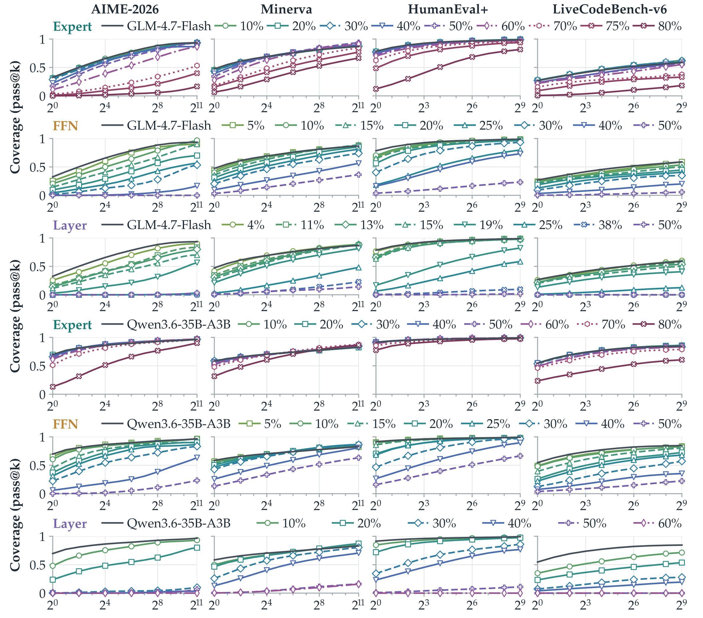
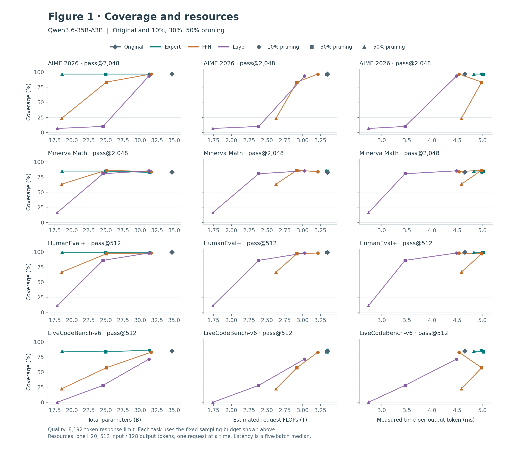
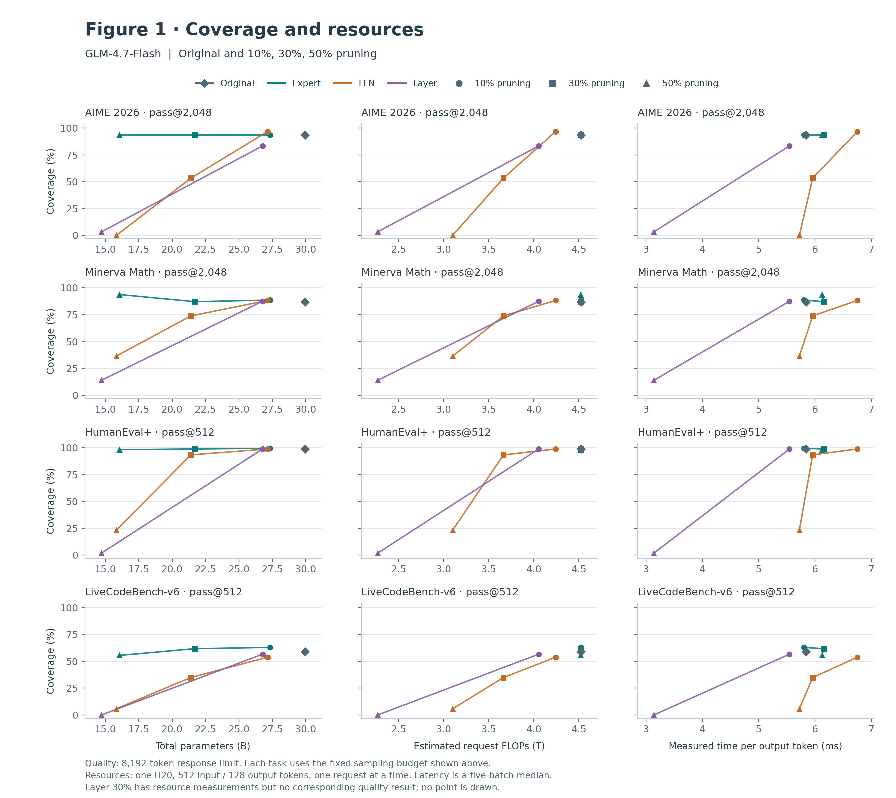

# Figure 1 · Reasoning coverage

[Back to figures](README.md) · [Figure 3](FIGURE3.md)

## Paper figure

**Pruned models can reach or exceed the original model's coverage.** Pass@k for Qwen3.6-35B-A3B and GLM-4.7-Flash across pruning structures, tasks, and ratios. The horizontal axis is the number of sampled attempts per problem. Rows separate models and pruning structures; columns separate tasks. This is the figure from the paper, reproduced at high resolution.

[Full-resolution PNG](assets/figure1_paper.png) · [Vector PDF](assets/figure1_paper.pdf)

## Resource comparisons

The following panels compare the **fixed-budget endpoints of Figure 1 against resource use**, separately for each task. Mathematics uses pass@2,048; code uses pass@512. The original sampling curves above retain their sampling-count axis. These companions cover the original model and the 10%, 30%, and 50% configurations with measured resources.

### Qwen3.6-35B-A3B

[PNG](assets/figure1_resources_qwen36.png) · [PDF](assets/figure1_resources_qwen36.pdf) · [Editable SVG](assets/figure1_resources_qwen36.svg)

### GLM-4.7-Flash

[PNG](assets/figure1_resources_glm47.png) · [PDF](assets/figure1_resources_glm47.pdf) · [Editable SVG](assets/figure1_resources_glm47.svg)

## Resource measurement definitions

The resource comparisons use **total parameters**, **analytically estimated FLOPs per request**, and **measured time per output token (TPOT)**. Resource measurements use one H20 GPU, BF16, 512 input tokens, 128 output tokens, and one request at a time. TPOT is the median across five timed batches after two warm-up batches. These fixed-length measurements describe execution cost; the reasoning evaluations separately use an 8,192-token response limit.

Colors identify pruning structures; marker shapes identify 10%, 30%, and 50% pruning. Diamonds mark the original model. Lines connect available configurations in pruning-ratio order. **GLM Layer 30% has resource measurements but no corresponding four-task quality result**, so it has no quality point. GLM Layer 10% removes 5/47 layers, displayed as 11% in the paper's length plot. See the [resource data](assets/resource_quality.csv), [all runtime measurements](assets/runtime_sweep.csv), and [accounting details](assets/CAPTIONS.md).
