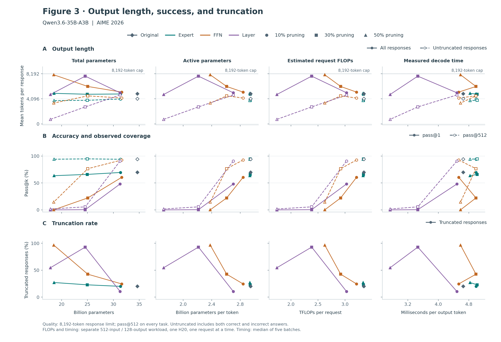
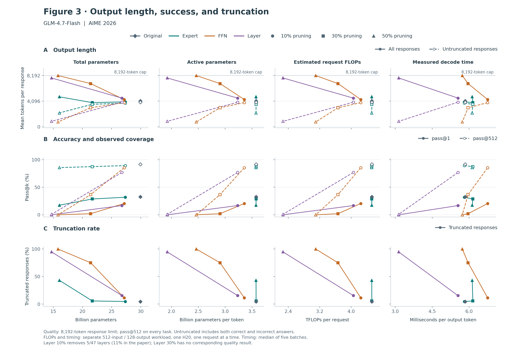
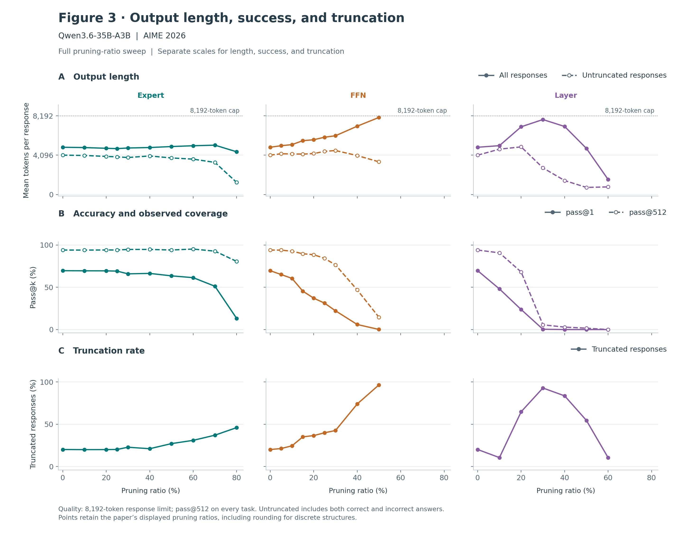
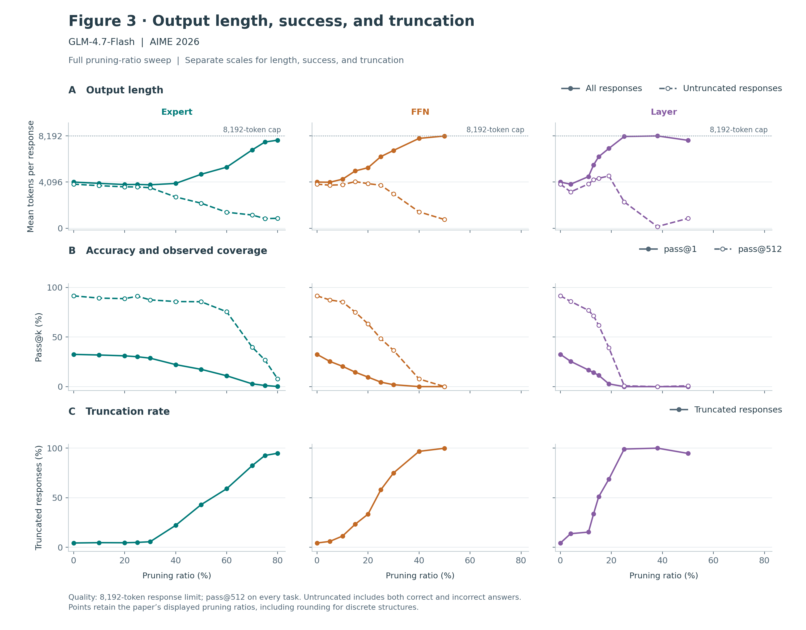
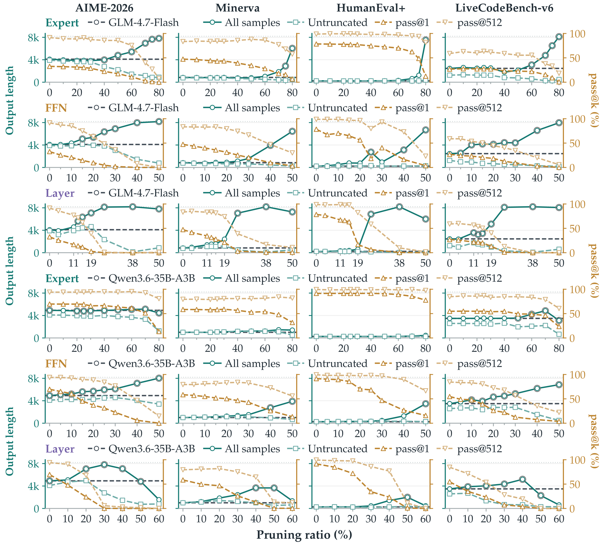

# Figure 3 · Length, success, and truncation versus resources

[Back to figures](README.md) · [Figure 1](FIGURE1.md)

**Revision: use resource-based horizontal axes and separate the metrics into aligned rows.** Each resource view has four columns: **total parameters, active parameters, estimated FLOPs, and measured decoding time**. Each row has its own vertical scale:

| Row | Measurement | How to read it |
| --- | --- | --- |
| **A — Output length** | Mean tokens per response | Solid lines show all responses; dashed lines show untruncated responses. The dotted line is the **8,192-token cap**. Untruncated includes correct and incorrect answers. |
| **B — Accuracy and coverage** | **pass@1** and **pass@512**, in percent | Solid lines show pass@1; dashed lines show pass@512. Figure 3 uses **k = 512 on all four tasks**. |
| **C — Truncation rate** | Percentage of responses reaching the cap | The full rate is plotted directly, replacing the original threshold markers. |

This layout lets readers compare length, success, and truncation without reading two vertical scales in one panel. **We will replace the original dual-axis presentation and add these resource views in the revised manuscript.**

## Resource comparisons

These views include the original model and available **10%, 30%, and 50%** configurations. The complete pruning-ratio sweeps follow below. [Data for the resource views](assets/figure3_resource_data.csv).

| Task | Qwen3.6-35B-A3B | GLM-4.7-Flash |
| --- | --- | --- |
| AIME 2026 | [PNG](assets/figure3_resources_qwen36_aime2026.png) · [PDF](assets/figure3_resources_qwen36_aime2026.pdf) · [Editable SVG](assets/figure3_resources_qwen36_aime2026.svg) | [PNG](assets/figure3_resources_glm47_aime2026.png) · [PDF](assets/figure3_resources_glm47_aime2026.pdf) · [Editable SVG](assets/figure3_resources_glm47_aime2026.svg) |
| Minerva Math | [PNG](assets/figure3_resources_qwen36_minerva.png) · [PDF](assets/figure3_resources_qwen36_minerva.pdf) · [Editable SVG](assets/figure3_resources_qwen36_minerva.svg) | [PNG](assets/figure3_resources_glm47_minerva.png) · [PDF](assets/figure3_resources_glm47_minerva.pdf) · [Editable SVG](assets/figure3_resources_glm47_minerva.svg) |
| HumanEval+ | [PNG](assets/figure3_resources_qwen36_humanevalplus.png) · [PDF](assets/figure3_resources_qwen36_humanevalplus.pdf) · [Editable SVG](assets/figure3_resources_qwen36_humanevalplus.svg) | [PNG](assets/figure3_resources_glm47_humanevalplus.png) · [PDF](assets/figure3_resources_glm47_humanevalplus.pdf) · [Editable SVG](assets/figure3_resources_glm47_humanevalplus.svg) |
| LiveCodeBench-v6 | [PNG](assets/figure3_resources_qwen36_lcb.png) · [PDF](assets/figure3_resources_qwen36_lcb.pdf) · [Editable SVG](assets/figure3_resources_qwen36_lcb.svg) | [PNG](assets/figure3_resources_glm47_lcb.png) · [PDF](assets/figure3_resources_glm47_lcb.pdf) · [Editable SVG](assets/figure3_resources_glm47_lcb.svg) |

### Qwen3.6-35B-A3B · AIME 2026

### GLM-4.7-Flash · AIME 2026

## Full pruning-ratio sweeps

These redrawn panels preserve **all available points from Figure 3**, with Expert, FFN, and Layer pruning in separate columns and pruning ratio on the horizontal axis. They use the same three metric rows and line styles as the resource views. This fuller sweep helps locate task-dependent changes in output length, success, and truncation. [Full length and success data](assets/length_diagnostics.csv).

| Task | Qwen3.6-35B-A3B | GLM-4.7-Flash |
| --- | --- | --- |
| AIME 2026 | [PNG](assets/length_qwen36_aime2026.png) · [PDF](assets/length_qwen36_aime2026.pdf) · [Editable SVG](assets/length_qwen36_aime2026.svg) | [PNG](assets/length_glm47_aime2026.png) · [PDF](assets/length_glm47_aime2026.pdf) · [Editable SVG](assets/length_glm47_aime2026.svg) |
| Minerva Math | [PNG](assets/length_qwen36_minerva.png) · [PDF](assets/length_qwen36_minerva.pdf) · [Editable SVG](assets/length_qwen36_minerva.svg) | [PNG](assets/length_glm47_minerva.png) · [PDF](assets/length_glm47_minerva.pdf) · [Editable SVG](assets/length_glm47_minerva.svg) |
| HumanEval+ | [PNG](assets/length_qwen36_humanevalplus.png) · [PDF](assets/length_qwen36_humanevalplus.pdf) · [Editable SVG](assets/length_qwen36_humanevalplus.svg) | [PNG](assets/length_glm47_humanevalplus.png) · [PDF](assets/length_glm47_humanevalplus.pdf) · [Editable SVG](assets/length_glm47_humanevalplus.svg) |
| LiveCodeBench-v6 | [PNG](assets/length_qwen36_lcb.png) · [PDF](assets/length_qwen36_lcb.pdf) · [Editable SVG](assets/length_qwen36_lcb.svg) | [PNG](assets/length_glm47_lcb.png) · [PDF](assets/length_glm47_lcb.pdf) · [Editable SVG](assets/length_glm47_lcb.svg) |

### Qwen3.6-35B-A3B · Full AIME sweep

### GLM-4.7-Flash · Full AIME sweep

## Resource definitions

The four horizontal axes show **total parameters**, **active parameters per token**, **analytically estimated FLOPs per request**, and **measured decoding time per output token**. B denotes a billion parameters; a TFLOP is 10¹² floating-point operations, a count rather than a rate. Active parameters count the weights used for each token, including attention, routing, always-active modules, selected experts, and the output head.

FLOPs and timing use a separate fixed-length workload: **one H20 GPU, BF16, vLLM 0.25.1, 512 input tokens, 128 output tokens, and one request at a time**. The prompt is processed once, followed by 127 further generation steps; one multiply–accumulate counts as two FLOPs. Time per output token is the elapsed time between the first and last output tokens divided by 127. The plotted value is the median of five timed batches after two warm-up batches. The reasoning evaluations use an **8,192-token response limit**.

Colors identify **Expert, FFN, and Layer** pruning; circles, squares, and triangles identify **10%, 30%, and 50%** pruning. Diamonds identify the original model. Lines connect available configurations in pruning-ratio order. GLM Layer 10% removes 5/47 layers, displayed as 11% in the paper. GLM Layer 30% has resource measurements but no corresponding four-task quality result, so its quality point is omitted.

[Resource and coverage data](assets/resource_quality.csv) · [All runtime measurements](assets/runtime_sweep.csv) · [Additional accounting details](assets/CAPTIONS.md)

## Original figure

View the original dual-axis Figure 3 for comparison

The original uses a left scale for length and a right scale for pass@1/pass@512; gray rings flag at least 20% truncation. The revised views above separate the scales and display the full truncation rate.

[PNG](assets/figure3_paper.png) · [PDF](assets/figure3_paper.pdf)

