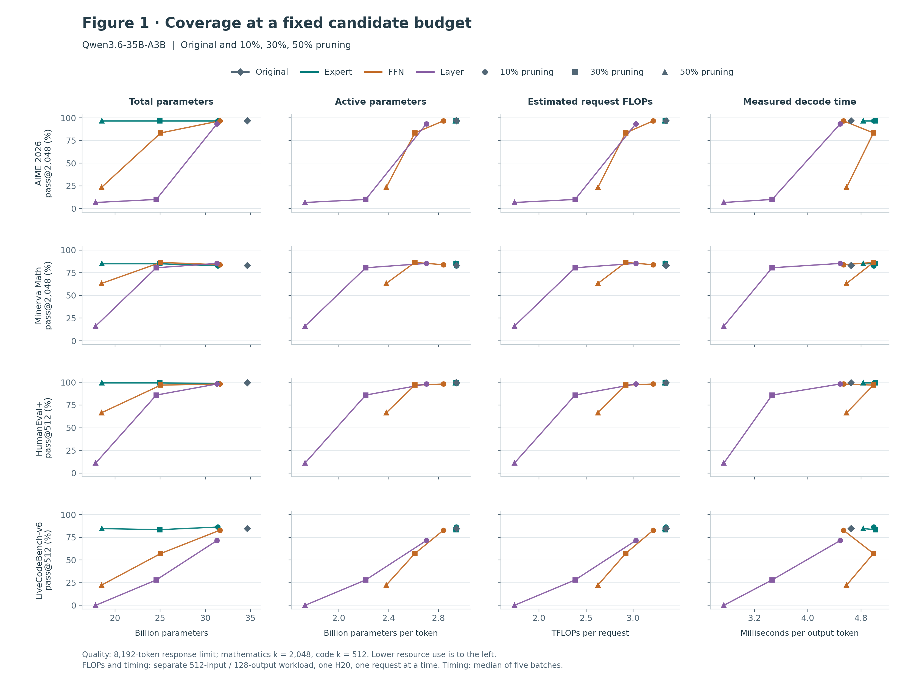
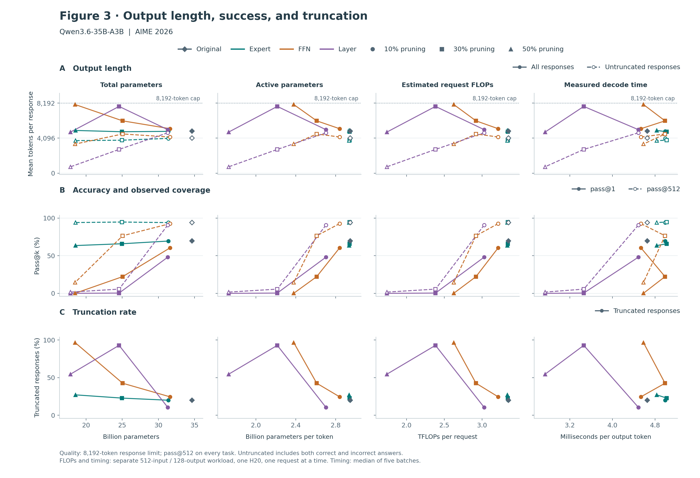

# Revised Figures 1 and 3

Figures revised in response to the requests for **resource-based comparisons** and a **clearer Figure 3**. Numerical results are reported in tables directly in the rebuttal.

| Figure | Revision | View all models and tasks |
| --- | --- | --- |
| **Figure 1** | Fixed-budget coverage versus **total parameters, active parameters, estimated FLOPs, and measured decoding time** | [Figure 1](FIGURE1.md) |
| **Figure 3** | The same four resource axes, with separate rows for **length, accuracy/coverage, and truncation**; full pruning-ratio sweeps are also redrawn | [Figure 3](FIGURE3.md) |

## Figure 1 · Coverage versus resources

Qwen3.6-35B-A3B is shown below. [View both backbones and download vector files](FIGURE1.md#resource-comparisons).

## Figure 3 · Separate metric rows on resource axes

Qwen3.6-35B-A3B on AIME 2026 is shown below. [View both backbones, all four tasks, and full pruning-ratio sweeps](FIGURE3.md).

Each figure page includes metric definitions, data, PNG/PDF/editable SVG downloads, and the original paper figure for reference. **We will incorporate these revisions into the next manuscript version.**
