# Supplementary figures for the rebuttal

This gallery compares **Expert, FFN, and Layer pruning** through reasoning coverage, sampling cost, resource use, and generation length. Each figure is available as a PNG preview, a PDF, and an editable SVG; the accompanying CSV files contain the plotted values.

| Analysis | Figures | Data and details |
|---|---|---|
| Cumulative generation-token budget | [Qwen](#qwen-cumulative-generation-token-budget), [GLM](#glm-cumulative-generation-token-budget) | [Curves](assets/token_budget_curves.csv), [table at 1,048,576 tokens](assets/token_budget_table_1048576.csv), [evaluation details](assets/TOKEN_BUDGET.md) |
| Coverage and resource use | [Coverage versus resources](#coverage-and-resource-use), [runtime sweep](#resource-measurements-across-pruning-ratios) | [Coverage/resource CSV](assets/resource_quality.csv), [runtime CSV](assets/runtime_sweep.csv), [measurement details](assets/CAPTIONS.md) |
| Output length, accuracy, and truncation | [Qwen task panels](#qwen-output-length-diagnostics), [GLM task panels](#glm-output-length-diagnostics) | [Length-diagnostic CSV](assets/length_diagnostics.csv), [definitions](assets/CAPTIONS.md) |
| Temperature and code coverage | [GLM temperature controls](#glm-code-temperature-controls) | [Curves](assets/glm_code_temperature_curves.csv), [per-problem counts](assets/glm_code_temperature_question_counts.csv), [evaluation details](assets/GLM_CODE_TEMPERATURE.md) |
| Independent sampling seeds | [AIME seed comparisons](#independent-generation-seeds) | [Run summaries](assets/seed_summary.csv), [curves](assets/seed_curves.csv), [per-question counts](assets/seed_question_counts.csv), [generation protocol](assets/INDEPENDENT_SEEDS.md) |
| Newly covered problems | [Solution audit](#newly-covered-problems) | [Derivation checks and reproducible enumeration](assets/solution_audit.md) |

## Qwen: cumulative generation-token budget

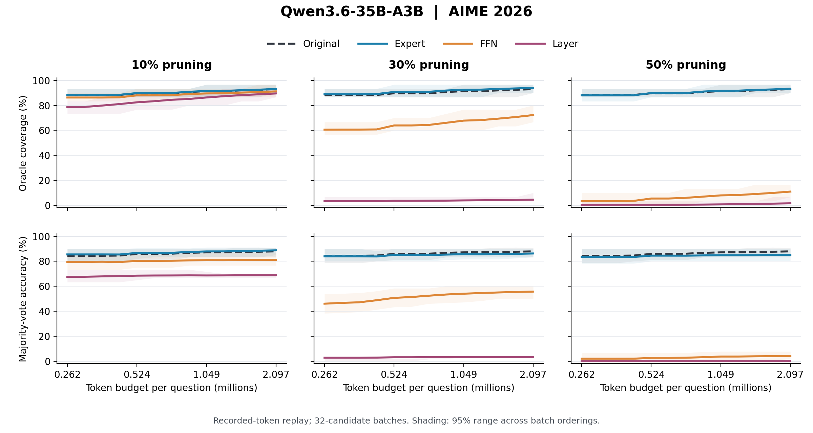

[PNG](assets/token_budget_qwen.png) · [PDF](assets/token_budget_qwen.pdf) · [SVG](assets/token_budget_qwen.svg) · [CSV](assets/token_budget_curves.csv)

## GLM: cumulative generation-token budget

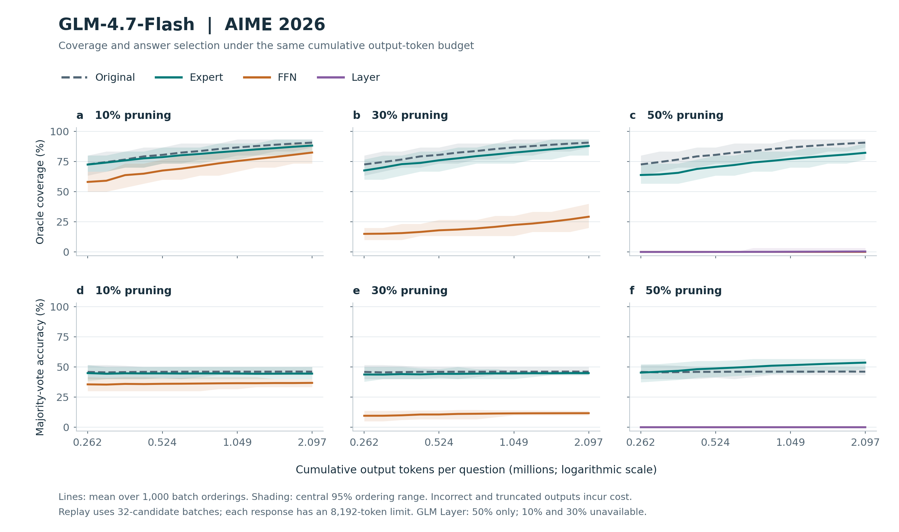

[PNG](assets/token_budget_glm.png) · [PDF](assets/token_budget_glm.pdf) · [SVG](assets/token_budget_glm.svg) · [CSV](assets/token_budget_curves.csv)

**How to read the token-budget figures.** The upper panels show oracle coverage; the lower panels show majority-vote accuracy. Each question receives the same cumulative output-token budget, including the cost of incorrect and truncated outputs. The analysis replays saved generations in batches of 32 candidates using each batch's recorded token cost. Only completed batches contribute answers; the remaining budget is charged to a simulated unfinished batch. Lines average 1,000 random batch orderings, and shaded regions show their central 95% range. These regions describe ordering variability within the saved generations. Each original candidate had an 8,192-token output limit. GLM Layer results use the available 50% configuration.

Majority voting uses the most frequent saved extracted answer, with uniformly broken ties. Empty answers cast no vote but still incur cost. See the [full caption and result table](assets/TOKEN_BUDGET.md), [answer-normalization sensitivity data](assets/token_budget_normalization_sensitivity.csv), and [evaluation settings](assets/token_budget_provenance.json).

## Coverage and resource use

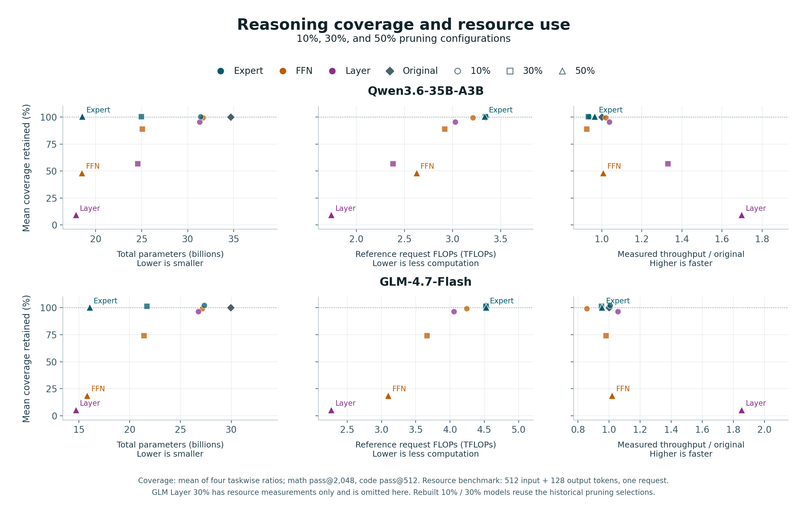

[PNG](assets/resource_quality.png) · [PDF](assets/resource_quality.pdf) · [SVG](assets/resource_quality.svg) · [CSV](assets/resource_quality.csv)

**Coverage retention** is the unweighted mean of four taskwise ratios: pruned pass@K divided by original pass@K. K is 2,048 for AIME 2026 and Minerva Math and 512 for HumanEval+ and LiveCodeBench-v6. Quality evaluations use an 8,192-token output limit. The three columns place the same quality results against model storage, reference request FLOPs, and measured throughput relative to the original model.

The runtime results come from the separate fixed-length workload described below. Rebuilt 10% and 30% models reuse historical pruning selections. GLM Layer 10% corresponds to the paper's rounded 11% configuration, with the same five layers removed. GLM Layer 30% has no matching math/code quality record and is omitted from this combined figure; its resource measurements appear in the next figure.

## Resource measurements across pruning ratios

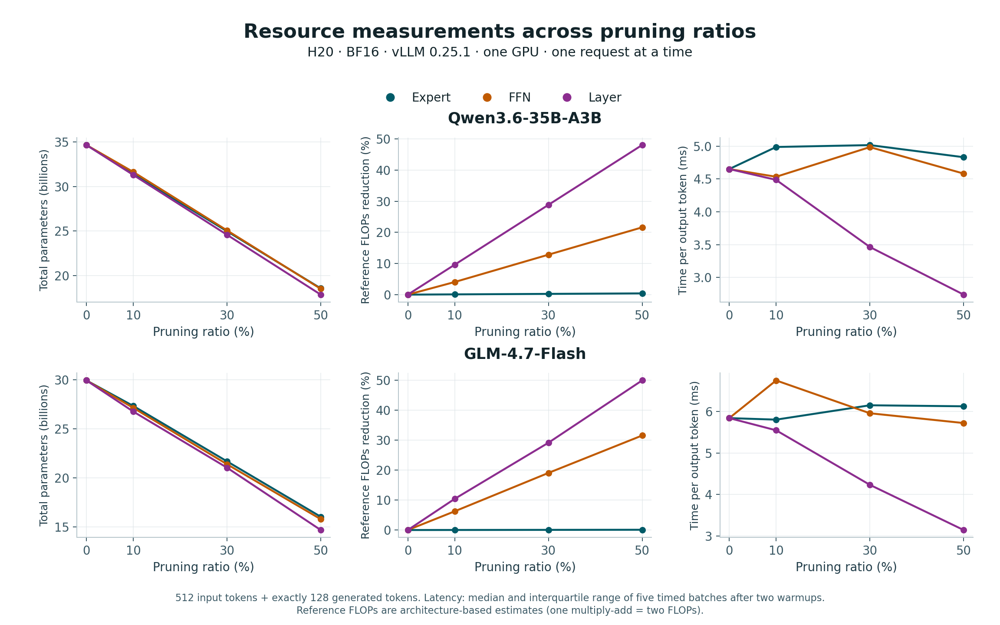

[PNG](assets/runtime_sweep.png) · [PDF](assets/runtime_sweep.pdf) · [SVG](assets/runtime_sweep.svg) · [CSV](assets/runtime_sweep.csv)

**Measurement conditions.** One H20 GPU, BF16, vLLM 0.25.1, tensor parallelism 1, 512 input tokens, exactly 128 generated tokens, and one request at a time. Lines show medians of five timed batches after two warmup batches; latency bands show the interquartile range. Reference FLOPs are architecture-based arithmetic counts, with one multiply-add counted as two FLOPs. This microbenchmark measures a fixed 128-token output workload; it is separate from end-to-end reasoning latency at the 8,192-token limit. GLM Layer 10% and 30% remove 5/47 and 14/47 layers, respectively. [Full captions](assets/CAPTIONS.md).

## Qwen: output-length diagnostics

For each task, the columns compare Expert, FFN, and Layer pruning. The top row shows mean output length for all samples and for untruncated samples; the middle row shows pass@1 and pass@512; the bottom row shows the percentage reaching the 8,192-token limit. **Untruncated means below the output limit, regardless of correctness.** Read the separation between length curves together with truncation and accuracy when assessing a task's pruning boundary. The figures retain the paper's displayed pruning ratios, including rounding for discrete structures.

### Qwen — AIME 2026

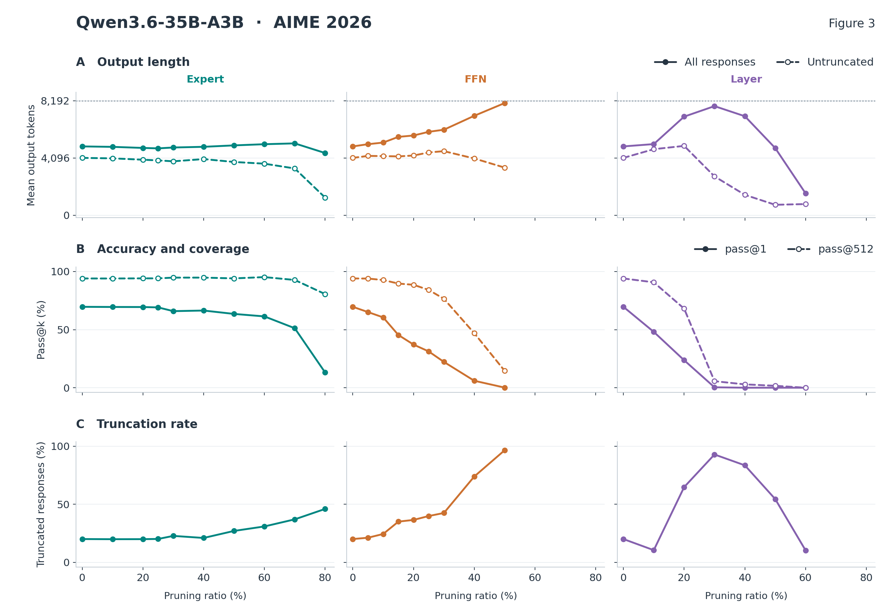

[PNG](assets/length_qwen36_aime2026.png) · [PDF](assets/length_qwen36_aime2026.pdf) · [SVG](assets/length_qwen36_aime2026.svg) · [CSV](assets/length_diagnostics.csv)

### Qwen — Minerva Math

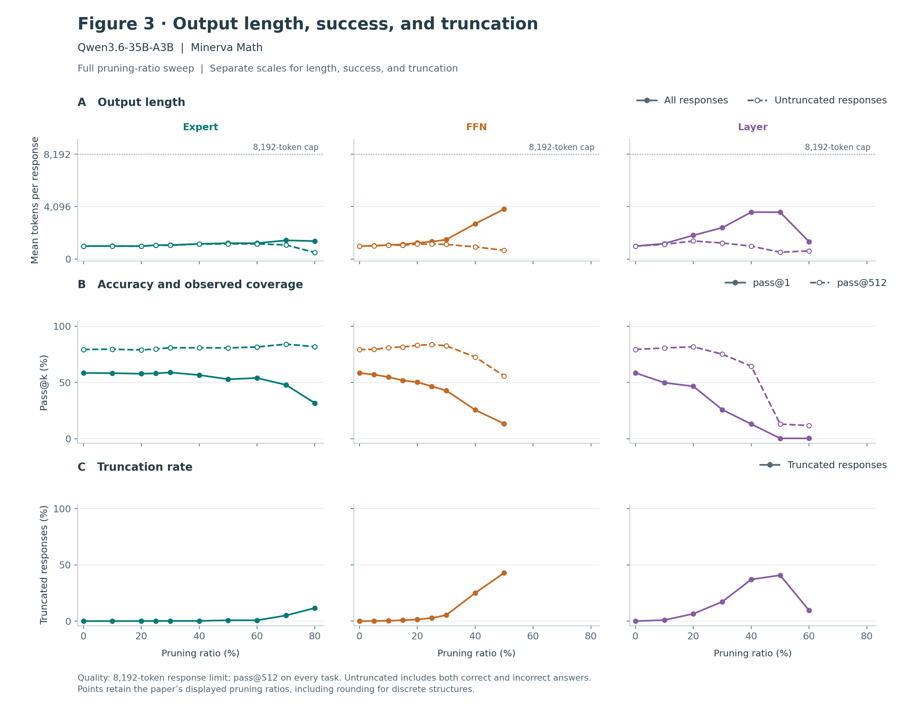

[PNG](assets/length_qwen36_minerva.png) · [PDF](assets/length_qwen36_minerva.pdf) · [SVG](assets/length_qwen36_minerva.svg) · [CSV](assets/length_diagnostics.csv)

### Qwen — HumanEval+

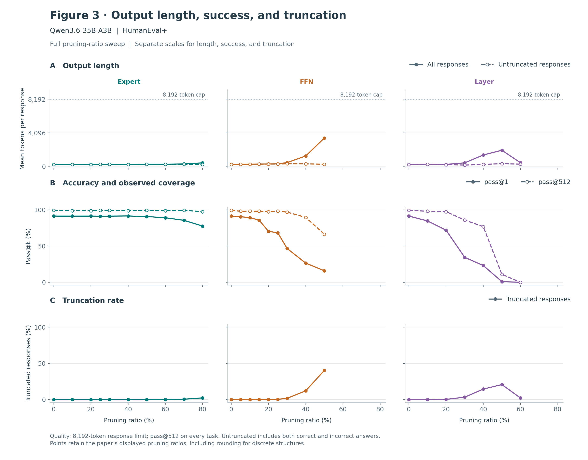

[PNG](assets/length_qwen36_humanevalplus.png) · [PDF](assets/length_qwen36_humanevalplus.pdf) · [SVG](assets/length_qwen36_humanevalplus.svg) · [CSV](assets/length_diagnostics.csv)

### Qwen — LiveCodeBench-v6

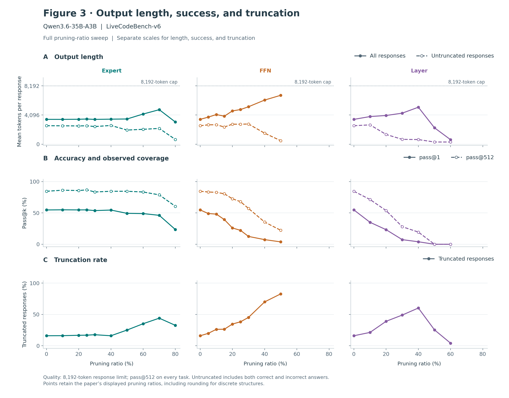

[PNG](assets/length_qwen36_lcb.png) · [PDF](assets/length_qwen36_lcb.pdf) · [SVG](assets/length_qwen36_lcb.svg) · [CSV](assets/length_diagnostics.csv)

## GLM: output-length diagnostics

The same panel definitions and 8,192-token limit apply to GLM. All pass@k values are recomputed from per-problem integer success and sample counts; pass@512 is used on all four tasks without extrapolation.

### GLM — AIME 2026

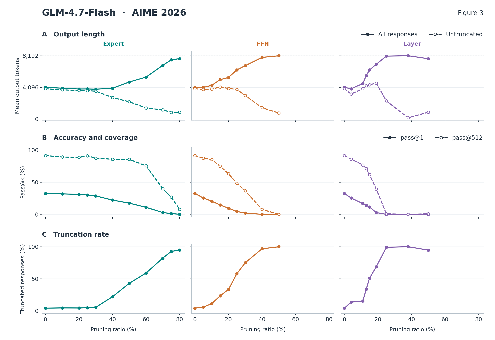

[PNG](assets/length_glm47_aime2026.png) · [PDF](assets/length_glm47_aime2026.pdf) · [SVG](assets/length_glm47_aime2026.svg) · [CSV](assets/length_diagnostics.csv)

### GLM — Minerva Math

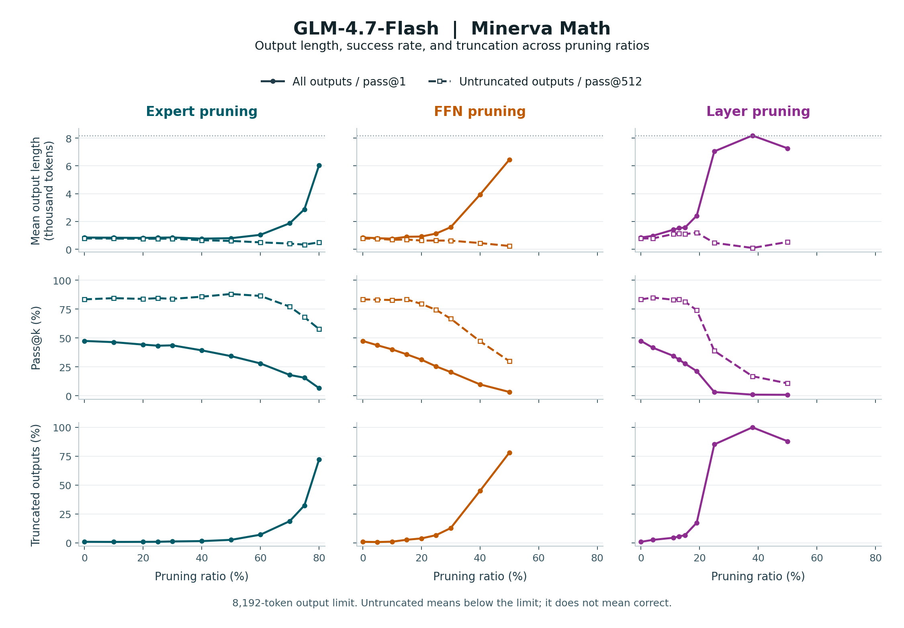

[PNG](assets/length_glm47_minerva.png) · [PDF](assets/length_glm47_minerva.pdf) · [SVG](assets/length_glm47_minerva.svg) · [CSV](assets/length_diagnostics.csv)

### GLM — HumanEval+

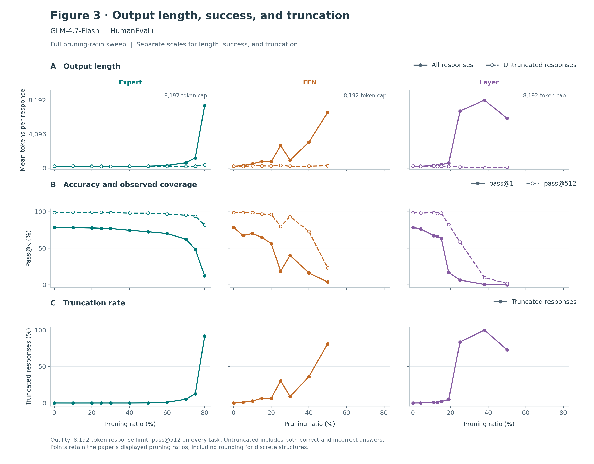

[PNG](assets/length_glm47_humanevalplus.png) · [PDF](assets/length_glm47_humanevalplus.pdf) · [SVG](assets/length_glm47_humanevalplus.svg) · [CSV](assets/length_diagnostics.csv)

### GLM — LiveCodeBench-v6

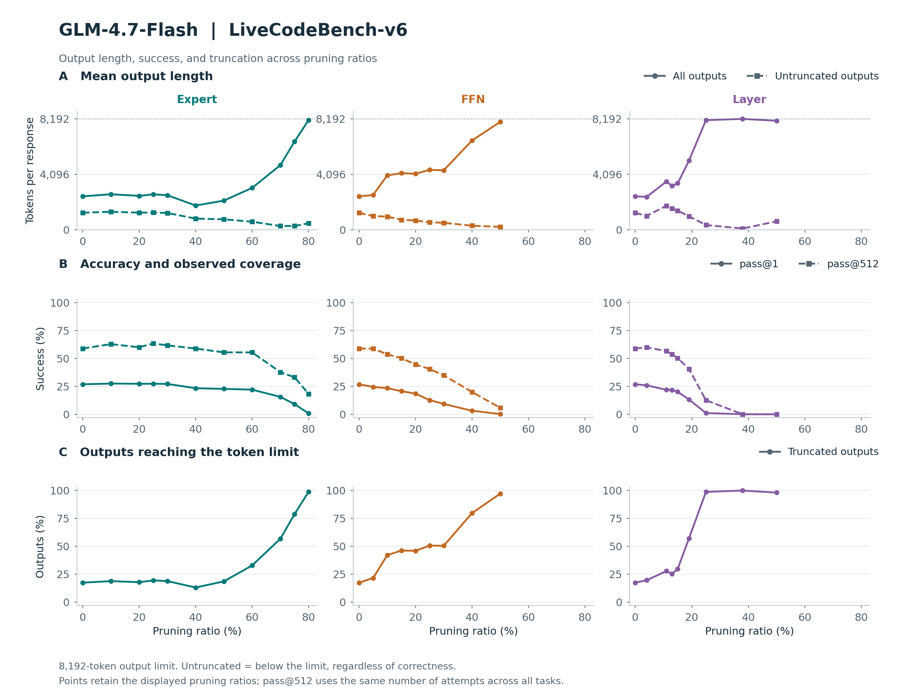

[PNG](assets/length_glm47_lcb.png) · [PDF](assets/length_glm47_lcb.pdf) · [SVG](assets/length_glm47_lcb.svg) · [CSV](assets/length_diagnostics.csv)

## GLM: code temperature controls

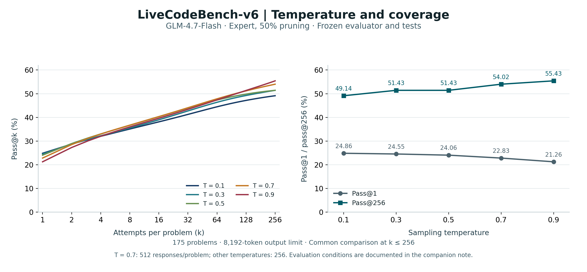

[PNG](assets/glm_code_temperature.png) · [PDF](assets/glm_code_temperature.pdf) · [SVG](assets/glm_code_temperature.svg) · [Summary CSV](assets/glm_code_temperature_summary.csv) · [Full curves](assets/glm_code_temperature_curves.csv)

**Higher temperature lowers single-attempt accuracy while increasing coverage at 256 attempts.** For GLM-4.7-Flash with 50% expert pruning, raising temperature from 0.1 to 0.9 changes pass@1 from 24.86% to 21.26% and pass@256 from 49.14% to 55.43%. All five temperatures use the same evaluator and test suite on 175 LiveCodeBench-v6 problems, with an 8,192-token output limit. The common endpoint is k = 256; temperature 0.7 has 512 responses per problem and the others have 256. See the [evaluation conditions](assets/GLM_CODE_TEMPERATURE.md) for test timeouts, scoring parallelism, and timing sensitivity.

## Independent generation seeds

[PNG](assets/aime_independent_seeds.png) · [PDF](assets/aime_independent_seeds.pdf) · [Editable SVG](assets/aime_independent_seeds.svg) · [Summary CSV](assets/seed_summary.csv) · [Full curves](assets/seed_curves.csv)

Each configuration has **two independent generation runs**, using seeds 1112 and 1113. Each run generates 256 new responses for each of the 30 AIME 2026 problems, with an 8,192-token output limit, temperature 0.7, top-p 0.95, decoding top-k 20, and repetition penalty 1.0. Colors identify structures; solid and dashed lines show the two seeds separately. Pass@256 is the fraction of problems solved at least once in that run. The [protocol and endpoint table](assets/INDEPENDENT_SEEDS.md) give all 16 results. [Per-question success counts](assets/seed_question_counts.csv) and [original/pruned solved-set overlap](assets/seed_solved_set_overlap.csv) are also available.

## Newly covered problems

The [solution audit](assets/solution_audit.md) examines the two newly covered AIME problem–configuration pairs identified by comparing solved sets at 2,048 candidates per problem. Both final answers match the benchmark labels, while both saved derivations contain errors. The note gives the concrete errors, exact enumeration for the cyclic-congruence example, and the solved-set overlap for Qwen3.5-122B-A10B. Final-answer coverage and derivation validity are reported separately.

The CSV percentages are on a 0–100 scale unless a field explicitly denotes a ratio. The length CSV repeats the original-model points because each pruning structure has its own baseline curve. Model names in the figures: Qwen3.6-35B-A3B and GLM-4.7-Flash.
