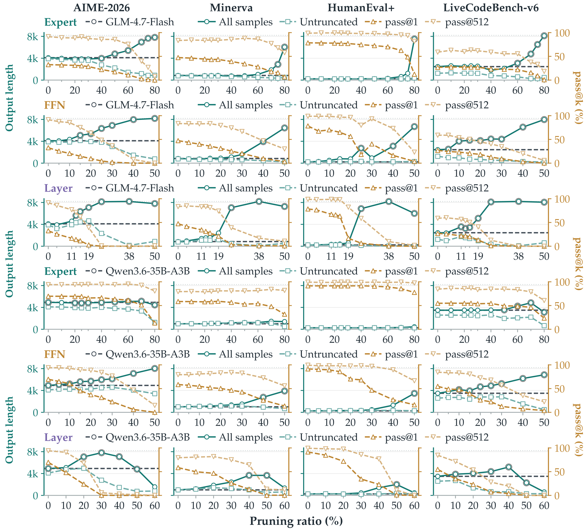

# Paper Figures 1 and 3

High-resolution figures accompanying the rebuttal. **Experimental result tables are included directly in the reviewer responses.**

| Paper figure | What it shows | View and download |
| --- | --- | --- |
| **Figure 1** | Pass@k across models, tasks, pruning structures, and ratios | [Original figure and resource comparisons](FIGURE1.md) · [PDF](assets/figure1_paper.pdf) |
| **Figure 3** | Output length, accuracy, coverage, and truncation | [Original figure, enlarged panels, and resource comparisons](FIGURE3.md) · [PDF](assets/figure3_paper.pdf) |

## Figure 1

## Figure 3

The figure pages provide enlarged views, downloadable vector files, data, and measurement definitions.
