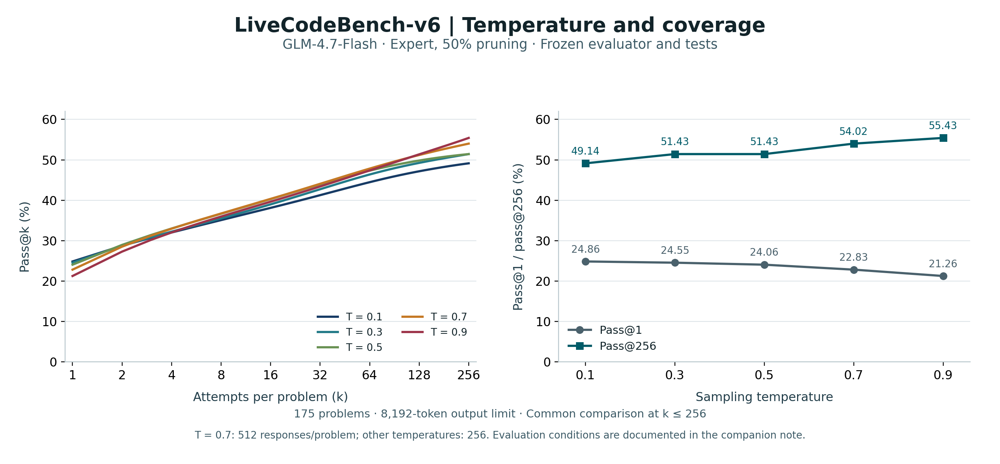

# GLM code: temperature, success frequency, and coverage

**Model:** GLM-4.7-Flash, Expert, 50% pruning. **Task:** 175 LiveCodeBench-v6 problems. Each response has an 8,192-token output limit.

| Temperature | Responses per problem | Pass@1 (%) | Pass@256 (%) |
|---:|---:|---:|---:|
| 0.1 | 256 | 24.86 | 49.14 |
| 0.3 | 256 | 24.55 | 51.43 |
| 0.5 | 256 | 24.06 | 51.43 |
| 0.7 | 512 | 22.83 | 54.02 |
| 0.9 | 256 | 21.26 | 55.43 |

[PNG](glm_code_temperature.png) · [PDF](glm_code_temperature.pdf) · [Editable SVG](glm_code_temperature.svg) · [Summary CSV](glm_code_temperature_summary.csv) · [Full curves](glm_code_temperature_curves.csv) · [Per-problem counts](glm_code_temperature_question_counts.csv)

The left panel shows pass@k for k = 1–256; the right panel compares pass@1 and pass@256. Higher temperature lowers single-attempt accuracy while increasing coverage at 256 attempts. All comparisons use the same k. For each problem with n generated responses and c correct responses, pass@k is estimated as 1 − C(n − c, k) / C(n, k), then averaged over problems. The fraction is zero when n − c < k. The temperature-0.7 curve uses all 512 responses to estimate performance at k ≤ 256; it is not plotted at a larger endpoint than the other temperatures.

## Evaluation conditions

All five temperatures use the same frozen evaluator and test suite. Each test case has a **6-second wall-clock limit**. The subprocess that executes a candidate program's complete test suite has a **120-second limit**. Identical extracted programs within each temperature are evaluated once, and that label is assigned to every occurrence; repeated outputs retain their original multiplicity in the accuracy estimates.

Formal scoring uses **8 workers per process at temperature 0.3 and 32 at the other temperatures**, with disjoint shards evaluated on separate hosts. A timing diagnostic identified a program close to the 6-second cutoff whose pass/fail outcome varied with execution timing. Diagnostics were kept separate from the reported formal judgments; no diagnostic success was substituted for a formal failure. The shared evaluator, tests, and time limits therefore coexist with the stated differences in execution parallelism and timing sensitivity.
