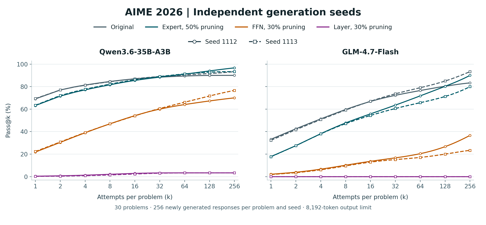

# Independent generation seeds on AIME 2026

Each of the 30 problems receives 256 newly generated responses for each configuration and seed. The two base seeds are 1112 and 1113; these are independent generation runs, not subsamples of an existing pool. Temperature is 0.7, top-p is 0.95, decoding top-k is 20, repetition penalty is 1.0, and each output is capped at 8,192 tokens. The chat template uses enable_thinking=False. Outputs are generated in chunks of 32. The generation seed for chunk j is base_seed × 1,000,003 + j × 7,919 + 13.

Pass@k is the mean over questions of 1 − C(n−c,k)/C(n,k), where n = 256 and c is the number of correct outputs. Thus pass@256 is the fraction of questions solved at least once in that run. Solid and dashed curves show the two seeds individually; no confidence interval is inferred from two seeds. Correctness refers to the scored final answer. Solved-set overlap does not establish derivation validity.

| Backbone | Configuration | Seed 1112: pass@1 / pass@256 (%) | Seed 1113: pass@1 / pass@256 (%) |
| --- | --- | ---: | ---: |
| Qwen3.6-35B-A3B | Original | 69.09 / 90.00 | 69.36 / 93.33 |
| Qwen3.6-35B-A3B | Expert, 50% pruning | 63.18 / 96.67 | 63.42 / 93.33 |
| Qwen3.6-35B-A3B | FFN, 30% pruning | 21.84 / 70.00 | 22.33 / 76.67 |
| Qwen3.6-35B-A3B | Layer, 30% pruning | 0.38 / 3.33 | 0.23 / 3.33 |
| GLM-4.7-Flash | Original | 33.23 / 83.33 | 32.30 / 93.33 |
| GLM-4.7-Flash | Expert, 50% pruning | 17.81 / 90.00 | 17.70 / 80.00 |
| GLM-4.7-Flash | FFN, 30% pruning | 2.10 / 36.67 | 1.86 / 23.33 |
| GLM-4.7-Flash | Layer, 30% pruning | 0.00 / 0.00 | 0.00 / 0.00 |

[PNG](aime_independent_seeds.png) · [PDF](aime_independent_seeds.pdf) · [Editable SVG](aime_independent_seeds.svg)

Download [per-run summaries](seed_summary.csv), [every plotted curve value](seed_curves.csv), [per-question success counts](seed_question_counts.csv), and [solved-set overlap](seed_solved_set_overlap.csv) between each pruned configuration and its original model at the same seed.
